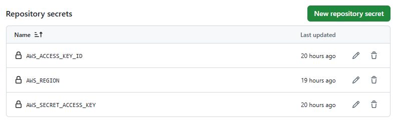
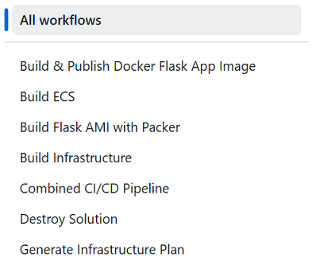
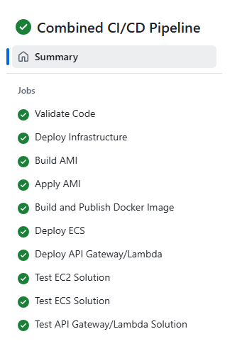
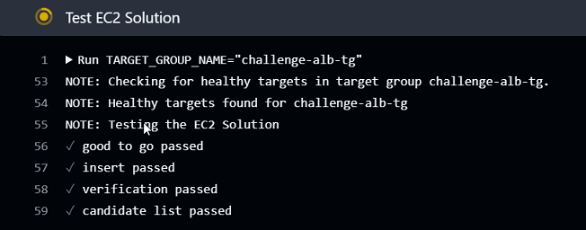

# AWS Code Examples: One Flask API on EC2, ECS and Lambda

One small Python candidate API deployed three ways on AWS, with Terraform,
Packer, Docker and GitHub Actions: on an **Auto Scaling group** of EC2
instances built from a **Packer** AMI, as a container on **ECS** from an
**ECR** image, and rewritten as **Lambda** functions behind **API
Gateway**. All three store candidates in the same **DynamoDB** table, use
least-privilege IAM roles, and can be built either with `apply.sh` or with
the GitHub Actions pipelines.

| Piece | Where | Role |
|---|---|---|
| **challenge-vpc** | `10.0.0.0/24`, us-east-2 | two public subnets, an internet gateway, and a DynamoDB gateway endpoint |
| **challenge-alb** + **Auto Scaling group** | public subnets | HTTP 80 to Flask on 8000; `t2.micro` instances from `flask_server_ami`, up to 4, scaled by CPU alarms (above 80% adds one) |
| **ecs-alb** + **ECS cluster** | public subnets | HTTP 80 to 8000; an ECS service of 2 `awsvpc` tasks (256 CPU, 256 MB) on 2 `t2.micro` container hosts |
| **flask-api** + **Lambda** | API Gateway | HTTP API with `GET /gtg`, `GET`/`POST /candidate/{name}`, `GET /candidates`, each to its own Python 3.13 function |
| **Candidates** | DynamoDB | keyed on `CandidateName`, TTL on `TimeToExist` |
| **flask_server_ami** | built by Packer | the Flask app as a systemd service |
| **flask-app** | ECR | the container image, `flask-app-rc1` |
| **`<account>-tfstate`** | S3 + DynamoDB lock | optional remote state, created by `00-backend` |

## Architecture

<picture>
  <source media="(prefers-color-scheme: dark)" srcset="architecture-dark.svg">
  
</picture>

Regenerate with `python3 make_diagram.py`.

- **`00-backend/`**: the S3 state bucket and DynamoDB lock table, built
  once outside the pipeline.
- **`01-infrastructure/`**: the network, the table, ECR, the EC2 load
  balancer, launch template and Auto Scaling group, roles and security
  groups.
- **`02-packer/`**: the AMI build and the Flask app (`scripts/`), including
  the `test_candidates.py` smoke test.
- **`03-docker/`**: the container build.
- **`04-ecs/`**: the ECS cluster, hosts, service and its load balancer.
- **`05-lambda/`**: the four functions and the API.
- **`.github/workflows/`**: `build_all.yml` (the whole build), `plan.yml`,
  `infrastructure.yml`, `packer.yml`, `docker.yml`, `ecs.yml`,
  `lambdas.yml` and `destroy.yml`.

Each folder also has its own README.

## Endpoints

| Method | Path | Returns |
|---|---|---|
| GET | `/gtg` | 200; with `?details=true`, connection details |
| GET | `/candidate/<name>` | the candidate, or 404 |
| POST | `/candidate/<name>` | `{"CandidateName": <name>}`, or 500 |
| GET | `/candidates` | every candidate, or 404 |

## Prerequisites

* [An AWS Account](https://aws.amazon.com/console/)
* [Install AWS CLI](https://docs.aws.amazon.com/cli/latest/userguide/getting-started-install.html)
* [Install Terraform](https://developer.hashicorp.com/terraform/install)
* [Install Packer](https://developer.hashicorp.com/packer/install)
* [Install Docker](https://docs.docker.com/engine/install/) and `zip`

The scripts are Bash, so run them from Linux.

### Remote state

The remote-state blocks in `01-infrastructure/backend.tf`,
`04-ecs/backend.tf` and `05-lambda/backend.tf` are commented out, so a local
run keeps state on disk. To use S3 state (which the pipelines need), apply
`00-backend` once to create the `<account>-tfstate` bucket and lock table,
then uncomment and point the three backend blocks at them.

## Deploy

```bash
git clone https://github.com/mamonaco1973/aws-example.git
cd aws-example
./apply.sh
```

`apply.sh` runs six phases:

1. **Infrastructure:** `01-infrastructure` with no instances in the Auto
   Scaling group yet.
2. **AMI:** Packer builds `flask_server_ami` in that VPC.
3. **Apply the AMI:** `01-infrastructure` again with the newest AMI and 2
   instances; the launch template gets a new version.
4. **Container:** builds the image and pushes it to ECR.
5. **ECS:** `04-ecs`.
6. **Lambda:** zips the functions and applies `05-lambda`.

Then run `validate.sh`, which waits for healthy targets and runs the smoke
test against each deployment:

```text
ubuntu@ip-10-1-0-11:~/uturndata-challenge$ ./validate.sh
NOTE: Checking for healthy targets in target group challenge-alb-tg.
NOTE: Healthy targets found on challenge-alb-tg.
NOTE: Testing the EC2 Solution
NOTE: URL for EC2 Solution is http://challenge-alb-2096975437.us-east-2.elb.amazonaws.com/gtg?details=true
✓ good to go passed
✓ insert passed
✓ verification passed
✓ candidate list passed
NOTE: Checking for healthy targets in target group ecs-tg.
NOTE: Healthy targets found on ecs-tg.
NOTE: Testing the ECS Solution.
NOTE: URL for ECS Solution is http://ecs-alb-213915415.us-east-2.elb.amazonaws.com/gtg?details=true
✓ good to go passed
✓ insert passed
✓ verification passed
✓ candidate list passed
https://7sz2uw5oql.execute-api.us-east-2.amazonaws.com
NOTE: Testing the API Gateway Solution.
NOTE: URL for API Solution is https://7sz2uw5oql.execute-api.us-east-2.amazonaws.com.
✓ good to go passed
✓ insert passed
✓ verification passed
✓ candidate list passed
```

## CI/CD pipelines

The **Combined CI/CD Pipeline** (`build_all.yml`) validates the Terraform and
Packer sources, runs the same phases, and finishes with the smoke test. The
other workflows run single steps for incremental work; run **Build
Infrastructure** first, then **Build Flask AMI with Packer** (and
Infrastructure again to pick up the AMI). All of them are started by hand.

To use them, create the remote state as above and add these repository
secrets:

* `AWS_ACCESS_KEY_ID`
* `AWS_SECRET_ACCESS_KEY`
* `AWS_REGION`









## Teardown

```bash
./destroy.sh
```

Besides `terraform destroy`, `destroy.sh` deregisters the Packer AMIs,
deletes their snapshots, and empties the ECR repository.

## Notes

- **Lab only.** The security groups allow SSH, HTTP and HTTPS from
  `0.0.0.0/0`.
- `01-infrastructure/keys/EC2_key_private` is a committed private key for
  the `challenge-key` key pair; the instances that used it are commented
  out, but the key pair is still created.
- `05-lambda/code/lambdas.zip` is a committed build artifact; `apply.sh`
  rebuilds it.
